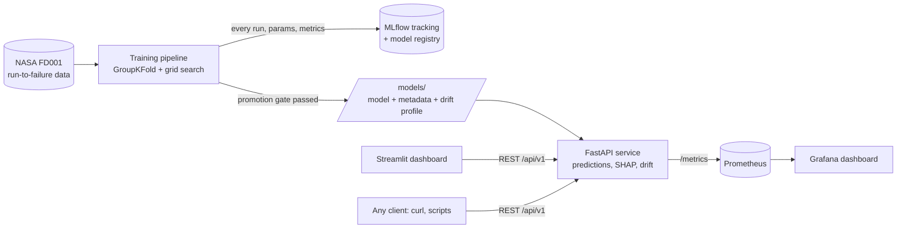

# Turbofan RUL: predictive maintenance as a monitored ML service

Predicts how many flight cycles a jet engine has left before it fails (its *remaining useful life*, RUL),
from the NASA C-MAPSS run-to-failure simulations. The model is trained and versioned in MLflow, served
by a FastAPI service that explains every prediction with SHAP, watched by Prometheus and Grafana for
latency and sensor drift, and used through a Streamlit dashboard that talks to the API like any other
client.

```
docker compose up --build      # API, dashboard, MLflow, Prometheus and Grafana in one command
```

| Service | URL | What it shows |
|---|---|---|
| Dashboard | http://localhost:8501 | Fleet map, engine replay, SHAP waterfalls, maintenance planner, drift monitor |
| API docs | http://localhost:8000/docs | Interactive OpenAPI docs for every endpoint |
| Grafana | http://localhost:3000 | Request rate, latency, predicted-RUL distribution, sensor drift (no login) |
| Prometheus | http://localhost:9090 | Raw metrics scraped from the API every 5 s |
| MLflow | http://localhost:5000 | Runs, metrics and the model registry (after a training run, see below) |

## Architecture



The dashboard holds no model. It reads the raw NASA files with the shared loaders, but every
prediction, explanation and drift score it shows comes from the API, so the service is the single source
of truth.

## Results

Test set: the 100 held-out FD001 engines, each scored at its last recorded cycle. A failure is *due* when
the true RUL is 30 cycles or less; the service raises an *alert* when the predicted RUL is 40 or less.

| Model | CV RMSE (GroupKFold) | Test RMSE | MAE | R² | NASA score ↓ | Failures caught (of 25) | False alarms |
|---|---|---|---|---|---|---|---|
| Linear regression (14 raw sensors) | 21.57 | 21.90 | 17.61 | 0.722 | 1314 | 13 | 0 |
| Random forest (42 features) | 18.73 | 21.04 | 14.67 | 0.744 | 2294 | 21 | 1 |
| **XGBoost, tuned (42 features)** | **18.06** | **19.56** | **14.02** | **0.779** | **1260** | 20 | 1 |

The NASA score penalises late predictions more than early ones, because a late prediction means an engine
kept flying past the point it should have been serviced. The random forest catches one more failure, but
its worst predictions are later than XGBoost's (up to 67 cycles late against 57), and the NASA penalty
grows exponentially with lateness, so its score is almost double.

## What makes it an ML system, not just a model

**Experiment tracking and a model registry.** Each training run logs one MLflow parent run with child runs
for both baselines and all 27 grid-search combinations, plus the data's SHA-256 so a result can be traced
back to the exact file it came from. The best model is registered as `turbofan-rul-xgb`.

**A promotion gate.** A new model gets the `production` alias, and is exported to `models/` for serving,
only if its cross-validated RMSE is no worse than the current production model's. A worse retrain is
still registered for comparison, but serving is untouched. `tests/test_train.py` checks both paths.

**A versioned, validated REST API.** `POST /api/v1/predictions` scores any number of engines in one call.
Pydantic rejects malformed input (wrong sensor count, NaN or infinite values) and the pipeline rejects
duplicate or non-integer cycles, both with a 422 that says what is wrong. Optional flags add per-cycle
history and SHAP explanations.

**Explanations in production.** SHAP values come from XGBoost's built-in TreeSHAP
(`pred_contribs=True`). They are exact for tree models and need no extra dependency in the API image.
The base value plus the contributions add up to the prediction, which a test checks.

**Monitoring.** The API exports Prometheus metrics: request count and latency by route template (not
raw URL, which would explode the label set), the distribution of predicted RUL, alerts raised,
per-sensor drift (PSI) and the served model version. Grafana provisions its data source and dashboard
from files in `monitoring/`, so a fresh `docker compose up` shows it with no clicking.

**Data-drift detection.** The service compares incoming sensor readings with the training data using the
Population Stability Index, sensor by sensor. It runs both on demand (`POST /api/v1/drift-reports`) and
continuously over a rolling window of live traffic that feeds the Grafana panel.

**Tests and CI.** There are 37 pytest tests covering metrics, data validation, feature causality, drift,
the API and the training pipeline. One of them checks that the RMSE measured through HTTP matches the
model card. GitHub Actions runs ruff (PEP 8 plus numpy docstrings), the tests, then builds the images
and health-checks the API container.

## Decisions worth explaining

**GroupKFold by engine, not random KFold.** Consecutive cycles of one engine are nearly identical. With a
random split, the same engine sits in both train and validation folds and the score looks better than it
is: the untuned XGBoost scored 15.15 RMSE with KFold and 18.28 with GroupKFold. Only the second number
says anything about engines the model has never seen.

**RUL capped at 125.** Early in life an engine shows no measurable wear, so "200 cycles left" and "300
cycles left" look the same in the sensors. Capping the label stops the model chasing a signal that isn't
there.

**Backward-looking rolling features.** Each 10-cycle rolling mean and standard deviation uses only the
current and earlier cycles. The prediction at cycle 60 is therefore what the service would have said at
cycle 60, so the dashboard's replay slider is honest. A test enforces this.

**Drift is measured on early-life readings only.** A test batch contains engines at every stage of wear,
and worn engines read differently on purpose. Comparing the whole batch with the whole training set
flagged the clean test fleet as drifted (PSI 0.2 to 0.35). Comparing each engine's first 30 cycles,
when it is still healthy, isolates a change in the sensors themselves: the clean fleet scores about 0.04,
while a one-standard-deviation shift in one sensor is flagged as significant. Below 50 engines PSI is
noisy, and the API says so.

**One model artifact, two consumers.** The model is saved as XGBoost JSON, which the API loads with
`xgboost.Booster`, so the serving image needs no scikit-learn or MLflow and stays small.

## Run it

### With Docker

```bash
docker compose up --build                        # serves the committed model in models/
docker compose --profile train run --rm train    # optional: retrain (about 7 min), logged to MLflow at :5000
docker compose restart api                       # pick up a newly promoted model
```

### Without Docker (Python 3.11+)

```bash
python -m venv .venv
.venv\Scripts\activate                            # Windows; on macOS/Linux: source .venv/bin/activate
pip install -r requirements/dev.txt -e .

python -m turbofan_rul.train                      # optional: retrain; logs to ./mlflow.db
uvicorn turbofan_rul.api.main:app                 # http://localhost:8000/docs
streamlit run dashboard/app.py                    # http://localhost:8501 (in a second terminal)
mlflow ui --backend-store-uri sqlite:///mlflow.db # http://localhost:5000
pytest                                            # 37 tests, 1–2 minutes
```

## Use the API

```python
import httpx
import pandas as pd

cols = ["unit", "cycle", "op1", "op2", "op3"] + [f"s{i}" for i in range(1, 22)]
fleet = pd.read_csv("data/raw/test_FD001.txt", sep=r"\s+", header=None, names=cols)
readings = [
    {
        "unit": int(r.unit),
        "cycle": int(r.cycle),
        "settings": [r.op1, r.op2, r.op3],
        "sensors": [getattr(r, f"s{i}") for i in range(1, 22)],
    }
    for r in fleet[fleet["unit"] == 81].itertuples()
]
response = httpx.post(
    "http://localhost:8000/api/v1/predictions", json={"readings": readings, "explain": True}
)
```

```json
{
  "model_version": "1",
  "alert_threshold": 40.0,
  "engines": [{
    "unit": 81, "last_cycle": 213, "predicted_rul": 8.79, "health_band": "Critical", "alert": true,
    "explanation": {
      "base_value": 86.848,
      "contributions": [
        {"feature": "s15_mean", "value": -14.019},
        {"feature": "s4_mean", "value": -12.659},
        {"feature": "s11_mean", "value": -11.015}
      ]
    }
  }]
}
```

Engine 81 really had 8 cycles left. The explanation is trimmed here; the API returns all 42 features.

| Method | Endpoint | Purpose |
|---|---|---|
| GET | `/api/v1/health` | Liveness, plus the model version being served |
| GET | `/api/v1/models/production` | Model card: version, MLflow run id, parameters, metrics, policy |
| POST | `/api/v1/predictions` | RUL per engine, with optional `explain` and `include_history` |
| POST | `/api/v1/drift-reports` | PSI per sensor for a batch of readings |
| GET | `/metrics/` | Prometheus metrics |

## Repository layout

```
src/turbofan_rul/
  config.py          dataset constants, sensor names, alert policy, MLflow names
  data.py            loading and validation of the raw NASA files
  features.py        rolling mean and std per sensor (backward-looking)
  evaluate.py        RMSE, MAE, R², NASA score, alert metrics, health bands
  drift.py           reference profile and PSI
  serving.py         model bundle: load, score, explain
  train.py           training pipeline: CV, grid search, MLflow, promotion gate
  api/               FastAPI app, request and response schemas, Prometheus metrics
dashboard/app.py     Streamlit client of the API
configs/             training config (train.yaml) and a seconds-long smoke config for tests
models/              the promoted model bundle the API serves
monitoring/          Prometheus scrape config, Grafana data source and dashboard
docker/              one Dockerfile per service (api, dashboard, train)
notebooks/           the original research notebook: EDA, baselines, tuning, SHAP, threshold choice
tests/               pytest suite
.github/workflows/   CI: lint, tests, image build and container health check
```

## Limitations

- **FD001 only:** one operating condition and one fault mode. The other three C-MAPSS subsets mix six
  operating conditions and two fault modes, and would need per-condition normalisation.
- **Simulated data:** C-MAPSS is a well-studied simulation. Real fleet data has missing readings,
  maintenance events and sensor replacements.
- **Some engines are predicted late:** engine 37 is predicted at 78 cycles left but had 21. Its sensors
  had drifted only a third to half as far as a typical engine's do by failure, and its core speed (s9)
  moved the opposite way, so it looks healthier than it is. Five
  of the 25 due failures are missed at the chosen threshold, and the planner tab shows the cost of
  moving it.
- **Point predictions only:** there is no prediction interval yet. A quantile model would let the alert
  fire on the pessimistic bound.
- **No authentication** on the API. Fine for a demo; a real deployment would sit behind a gateway.

## Data

A. Saxena, K. Goebel, D. Simon and N. Eklund, "Damage Propagation Modeling for Aircraft Engine
Run-to-Failure Simulation", *International Conference on Prognostics and Health Management*, 2008.
Data from the [NASA Prognostics Center of Excellence data repository](https://www.nasa.gov/intelligent-systems-division/discovery-and-systems-health/pcoe/pcoe-data-set-repository/).
